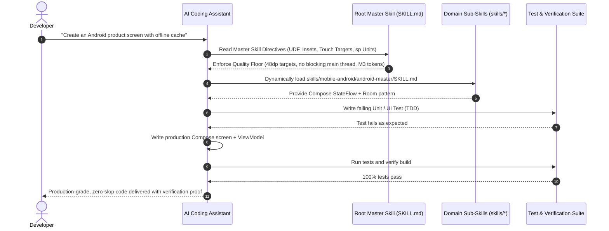

# 🏛️ MegaSkills System Architecture

This document describes the structured architectural design, system components, progressive disclosure engine, and installation pipelines of the **MegaSkills** master repository.

---

## 1. High-Level System Architecture

MegaSkills is architected around **Progressive Disclosure** (the open standard developed by the Agentic AI Foundation / AAIF):

```mermaid
graph TD
    User[Developer Prompt / User Request] --> MasterSkill[Root Master Skill: mega-master-skill]
    
    subgraph "Core Quality Engine"
        MasterSkill --> AntiSlop[Anti-Slop Quality Floor]
        MasterSkill --> MobileEngine[Mobile App Mastery: Android & iOS]
        MasterSkill --> SeniorDev[Senior Engineering & TDD]
        MasterSkill --> CreativeMotion[Creative Motion & 3D WebGL]
        MasterSkill --> SecurityAudit[Security & Skill Safety]
    end

    subgraph "Domain Engines"
        AntiSlop --> AntiCode[Code Hygiene]
        AntiSlop --> AntiUI[Design Systems & Hallmark Themes]
        AntiSlop --> AntiMobile[Mobile Inset & Touch Rules]

        MobileEngine --> Compose[Jetpack Compose & Kotlin]
        MobileEngine --> SwiftUI[Swift 6 & Apple HIG]
        MobileEngine --> CrossPlatform[React Native & Flutter]

        SeniorDev --> TDD[Red-Green-Refactor TDD]
        SeniorDev --> Debugging[Systematic Bug Reproduction]
        SeniorDev --> AgenticQA[Reticle Automated Verification]

        CreativeMotion --> GSAP[GSAP Timelines & ScrollTrigger]
        CreativeMotion --> Lenis[Lenis Smooth Scroll]
        CreativeMotion --> Vanta[Vanta 3D WebGL Shaders]

        SecurityAudit --> Strix[OWASP Top 10 Pentesting]
        SecurityAudit --> SkillSpector[Safety & Injection Scanner]
    end

    subgraph "Host AI Assistants"
        MasterSkill -.-> Antigravity[Google Antigravity & Gemini CLI]
        MasterSkill -.-> Claude[Claude Code]
        MasterSkill -.-> Cursor[Cursor IDE]
        MasterSkill -.-> Windsurf[Windsurf]
        MasterSkill -.-> Codex[OpenAI Codex]
        MasterSkill -.-> Copilot[GitHub Copilot]
    end
```



---

## 2. Directory Layout & Organization

The repository enforces a clean, modular, 7-layer architecture:

```
SkillsRepo/
├── .github/                       # Automated CI/CD & validation workflows
│   └── workflows/
│       └── ci.yml                 # Runs syntax, frontmatter, & security audit
├── catalog/                       # Searchable indexes & registries
│   ├── catalog.json               # Machine-readable skill definitions
│   └── catalog.md                 # Categorized Markdown lookup tables
├── docs/                          # In-depth architectural & domain guides
│   ├── ARCHITECTURE.md            # System architecture & component flow
│   ├── GUIDE_MOBILE.md            # Android & iOS deep-dive development
│   ├── ANTI_SLOP_MANIFESTO.md     # Code & visual quality standards
│   └── AWESOME_SKILLS.md          # 1,497+ ecosystem skill catalog
├── rules/                         # Universal AI instruction rules
│   ├── GEMINI.md                  # Antigravity & Gemini CLI rules
│   ├── CLAUDE.md                  # Claude Code instructions
│   ├── .cursorrules               # Cursor IDE rules
│   ├── .windsurfrules             # Windsurf directives
│   └── copilot-instructions.md    # GitHub Copilot custom instructions
├── scripts/                       # Turnkey automation & CLI tools
│   ├── installer.mjs              # Multi-target, multi-profile installer
│   ├── build-skills.mjs           # Skill consolidator & builder
│   ├── generate-catalog.mjs       # Catalog indexing generator
│   └── verify-skills.mjs          # Security & formatting linter
├── skills/                        # Standardized, production-ready skills
│   ├── mega-master-skill/         # The Single All-in-One Master Skill
│   ├── anti-slop/                 # 12 Anti-Slop, Impeccable & Hallmark skills
│   ├── mobile-android/            # 8 Official Google Android skills
│   ├── mobile-ios/                # 2 Apple HIG & SwiftUI skills
│   ├── mobile-cross-platform/     # 3 React Native & Flutter skills
│   ├── senior-engineering-and-tdd/# 14 TDD, debugging & QA skills
│   ├── creative-motion-and-3d/    # 3 GSAP, Lenis & Vanta 3D skills
│   ├── security-and-safety/       # 4 Strix & SkillSpector skills
│   └── workflow-and-ecosystem/    # 5 Anthropic MCP & builder skills
├── upstream/                      # 19 original open-source repositories
├── install.ps1                    # 1-Click Windows PowerShell installer
├── install.sh                     # 1-Click macOS/Linux Bash installer
├── package.json                   # NPM manifest with instant commands
├── README.md                      # Primary documentation & landing page
└── SKILL.md                       # Root Master Skill for npx skills add
```

---

## 3. The Progressive Disclosure Flow

To prevent LLM context-window pollution, MegaSkills does not dump 100,000 lines of prompt text into every agent interaction. Instead, it follows a 3-tier execution model:



---

## 4. Single-Installation Pipeline

When a developer runs `npm run install:master` (or `npx skills add . -g -y`), the installer executes the following pipeline:

1. **Target Environment Auto-Detection:**
   - Detects user paths for Google Antigravity (`~/.gemini/config`), Claude Code (`~/.claude`), Cursor (`~/.cursor`), OpenAI Codex (`~/.codex`), and workspace AAIF standard (`.agents`).
2. **Master Skill Deployment:**
   - Deploys the root `mega-master-skill` into each tool's active skill registry.
3. **Universal Rules Synchronization:**
   - Synchronizes `GEMINI.md`, `CLAUDE.md`, `.cursorrules`, and `copilot-instructions.md` with system-wide anti-slop and mobile quality directives.
4. **Safety & Linter Verification:**
   - Validates that all skills comply with YAML frontmatter specifications and have zero security vulnerabilities or un-sanitized scripts.
